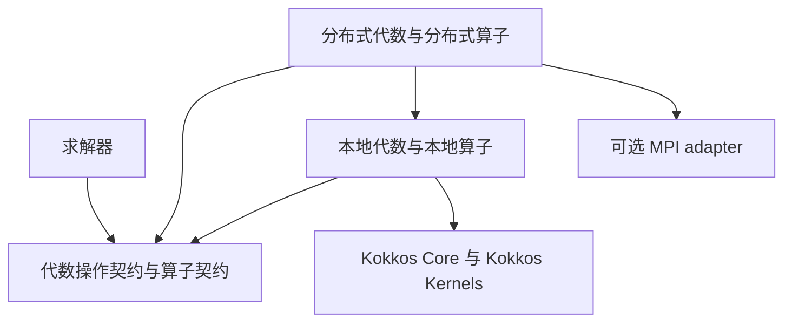

# numerix Design Document

> C++20 + Kokkos-native 的通用科学计算基础库。numerix 不提供 FEM/FVM/BEM 框架，
> 而提供所有离散方法共享的数值执行模型。

状态：阶段 1 动态代数已落地（v0.1，含 Kokkos-native 纠偏）；阶段 2 的求解器代数契约已确定，尚未实现。
本文件是唯一的设计记录；
与代码不一致时以本文件为准并同步修正代码。

## 1. 设计目标

1. 仅 C++20。不使用 `std::mdspan`、`std::expected`、modules，因为科学计算环境升级慢。
2. Kokkos-native 可移植性：Serial / OpenMP / CUDA / HIP / SYCL 由 `Kokkos::ExecutionSpace`、
   `Kokkos::MemorySpace`、`Kokkos::View` 提供，numerix 不重新设计执行抽象。
3. 零开销抽象：本地 `Apply(exec, x, y)` 的最终形态是 Kokkos kernel + SIMD/GPU kernel，
   热路径中不出现虚调用、`std::function`、堆分配与运行时分派。
4. 强编译期安全：公共模板 API 全部由 concept 约束；非法空间组合在模板实例化阶段就被拒绝。
5. 同一份源码在主机与设备上语义一致：标量、定长代数与所有 kernel 内可调用的函数都必须是
   Kokkos 可移植的。

## 2. 核心哲学

依赖保持单向。下图箭头表示上层使用下层，求解器与分布式实现为后续工作：



本地容器与 View 内核不依赖分布式层。求解器通过静态绑定的代数操作与算子接口表达计算，
不直接依赖 MPI、某个 CSR 实现或某个 owning 容器。分布式语义现在确定，MPI 实现留到阶段 4。

FEM/FVM/FDM/FDTD/BEM 的共同部分不是 mesh，而是数据搬运、线性代数、算子、求解器与执行模型。
因此 numerix 不出现 `Mesh -> Field -> PDE -> Solver` 这条链。

职责划分（越靠下越接近 Kokkos，越靠上越接近数学语义）：

```text
algebra / solver semantics      numerix：数学语义与接口
LinearOperator                  numerix：编译期算子契约
Kokkos Views / containers       numerix::Vector：owning 存储
Kokkos Kernels operations       BLAS / 稀疏容器：成熟 kernel
explicit ExecutionSpace instance  stream / queue
Kokkos                          machine model
CPU / CUDA / HIP / SYCL
```

## 3. 模块与目录

```text
include/numerix/
├── core/          scalar（ScalarTraits）/ concepts（Kokkos 概念再导出 + numerix 概念）
├── execution/     Kokkos 执行空间别名
├── memory/        Kokkos 内存空间别名
├── algebra/       blas1 / StaticVector / StaticMatrix / Vector / MultiVector
├── operator/      LinearOperatorFor 编译期算子契约 / SparseOperator
├── solver/        线性与非线性求解器（后续）
├── numerics/      时间积分等数值方法（后续）
├── distributed/   MPI 层（后续，可选依赖）
├── diagnostics/   Logger（后续：Timer、ConvergenceMonitor）
└── backend/       可选后端 adapter（后续）
```

`src/` 只放无法放入头文件的实现（当前仅 `diagnostics/logger.cpp`）。

## 4. 依赖策略

必需依赖两个，且必须版本同步：

- **Kokkos Core**：执行空间、内存空间、`View`、并行原语。
- **Kokkos Kernels**：portable BLAS-1/2/3 与稀疏容器（`KokkosSparse::CrsMatrix` 属于它，不属于 Core）。

numerix 不实现 thread pool、CUDA wrapper、OpenMP 抽象、allocator 抽象，也不自己重写 BLAS 内核：
numerix 拥有语义与接口，成熟 kernel 交给 Kokkos Kernels。

可选依赖一律通过 adapter 接入（`backend/eigen`、`backend/petsc`、`backend/ginkgo`、`backend/hdf5`、
`backend/mpi`、`backend/lapack`），可选依赖不得出现在核心头文件中。

## 5. 核心约定

### 5.1 标量：ScalarTraits 是唯一入口

一个类型是 numerix 标量，当且仅当它有合法的 `ScalarTraits<T>` 特化：

```cpp
template <class T> struct ScalarTraits;

template <std::floating_point T>
struct ScalarTraits<Kokkos::complex<T>> {
    using value_type = Kokkos::complex<T>;
    using real_type  = T;

    KOKKOS_INLINE_FUNCTION static constexpr value_type Conj(const value_type&) noexcept;
    KOKKOS_INLINE_FUNCTION static constexpr real_type  SquaredMagnitude(const value_type&) noexcept;
};
```

- 复数标量是 `Kokkos::complex`，不是 `std::complex`：后者在设备端不可用。
- `Scalar` 概念由"存在合法 traits"定义，而不是由 `is_floating_point || is_std_complex` 定义；
  它检查 real_type 是无 cv/ref 的对象类型，以及 Conj / SquaredMagnitude 的结果能转换为相应值类型，
  不要求 traits 提供未被使用的别名，不把所有算术能力都放进 Scalar。
- `Conj` 将 traits 结果转换为无 cv/ref 的标量值；即使显式指定引用类型，也不交出悬空引用。
  两个标量辅助函数的 noexcept 跟随实际 traits 调用和结果转换。
- `ScalarElement<T>` 在 Scalar 基础上要求 T 是无 cv/ref 的值类型，供 owning 容器使用；
  只读数据通过 const 容器或 const View 表达。
- 新标量可增加 ScalarTraits，但这只建立 numerix 语义。动态 BLAS / 稀疏乘法还需要完整的
  Kokkos Kernels ArithTraits 支持；traits 注册不能代替目标执行后端的真实编译与数学验证。
- 内核只通过 `ScalarTraits` 取实部类型与共轭/模平方语义（`RealOfT<T>`、`Conj`、`SquaredMagnitude`），
  这三个函数都是 `KOKKOS_INLINE_FUNCTION constexpr`。

### 5.2 概念优先，且以 Kokkos 概念为准

Kokkos 已经给出 `Kokkos::ExecutionSpace` / `Kokkos::MemorySpace` 两个 concept 与
`Kokkos::SpaceAccessibility`，numerix 直接再导出，不重复定义结构契约：

```cpp
using Kokkos::ExecutionSpace;
using Kokkos::MemorySpace;

template <class Exec, class Mem>
concept AccessibleFrom = ExecutionSpace<Exec> && MemorySpace<Mem> &&
    static_cast<bool>(Kokkos::SpaceAccessibility<Exec, Mem>::accessible);

template <class V, class Exec = DefaultExecutionSpace>
concept DenseVector = Kokkos::is_view_v<V> && V::rank == 1 &&
    AccessibleFrom<Exec, typename V::memory_space>;

template <class V, class Exec = DefaultExecutionSpace>
concept MutableDenseVector = DenseVector<V, Exec> && !std::is_const_v<typename V::value_type>;
```

- 契约围绕 `rank` / `value_type` / `extent` / `memory_space` / 可访问性 / 可写性建立，
  **不围绕裸指针**：设备端 `Data()` 在主机上不可解引用，subview、跨步视图与分布式向量也不该用指针表达。
- 非法的空间组合（设备内存 + 主机执行流）在模板实例化阶段被拒绝，而不是运行时出错。
- `DenseVector` / `DenseMultiVector` 描述可访问的本地 View，不描述全局所有权或分布兼容性；
  相同 extent 不足以证明两个分布式向量属于同一向量空间。

### 5.3 View 不再封装，Vector 只负责所有权

不定义 `numerix::View`。`Kokkos::View` 是底层基础，直接使用。
`Vector`、`MultiVector` 与它们交出的 View 均为本地存储，不隐含 communicator、全局编号或 ghost 所有权。
以后分布式对象组合这些存储与分布信息，不改变现有容器的本地职责。

`numerix::Vector` 是 **owning、move-only 的存储**，没有数学成员函数：

```cpp
template <ScalarElement T, MemorySpace Mem = DefaultMemorySpace>
class Vector {
public:
    using view_type = Kokkos::View<T*, Mem>;
    using const_view_type = typename view_type::const_type;

    explicit Vector(std::size_t size);
    explicit Vector(view_type values) noexcept;   // 接管已有 View 的所有权

    Vector(const Vector&) = delete;
    Vector(Vector&&) noexcept = default;

    std::size_t Size() const noexcept;

    T* Data() noexcept;
    const T* Data() const noexcept;

    view_type View() noexcept;
    const_view_type View() const noexcept;
};
```

理由与后果：

- Kokkos `View` 的拷贝是引用计数式句柄共享，与"数学向量"的直觉冲突；隐式共享会让 `a = b` 语义难预测。
  因此 `Vector` 删除拷贝，需要复制时显式写 `Clone(exec, x)` / `DeepCopy(exec, dst, src)`。
- 需要别名、subview 或跨步视图时直接用 `Kokkos::View`，不通过 `Vector` 表达。
- `const Vector` 只能交出 `const_view_type`，与 Kokkos 的 `View<double*>`（const 句柄、可写数据）与
  `View<const double*>`（只读数据）区分一致。

### 5.3.1 MultiVector：列向量的 owning 存储

`MultiVector<T, Mem>` 遵循 Vector 的 move-only 与 const 语义。`View()` 返回
`Kokkos::View<T**, Kokkos::LayoutLeft, Mem>`，维度为 `(Rows(), Columns())`，
不引入独立的列访问或数学成员接口。列、块与别名直接通过 `Kokkos::subview` 表达。
`Clone(exec, x)` 分配独立存储，`DeepCopy(exec, dst, src)` 要求两个维度一致。

`DenseMultiVector` / `MutableDenseMultiVector` 分别约束 rank-2 View 的可访问性与可写性。
`ColumnDots(exec, x, y, result)` 将相同尺寸多向量的对应列内积写入 rank-1 输出，
调用 KokkosBlas 的多向量 dot；它不是 `X^H Y`，不做单列广播。
输出与输入不得重叠。零行的内积为零，零列返回空结果。
标量类型必须一致，复数第一参数共轭，遵循向量已有的 Euclidean 内积约定。
操作使用显式 execution-space instance；输出返回主机前需由调用方 fence。
`ColumnDots` 只归约输入 View 中的本地行，不执行跨进程归约，也不识别或排除 ghost。

### 5.4 BLAS-1：numerix 定接口，Kokkos Kernels 出内核

```cpp
Scale(exec, alpha, x);      Axpy(exec, alpha, x, y);
Dot(exec, x, y);            Norm2(exec, x);
```

- `DenseVector` / `DenseMultiVector` 只检查本地 View 的结构。数值运算另要求
  `KokkosScalar<T>`：有效的 ScalarElement，且 Kokkos Kernels 已注册 ArithTraits。
  整数 View、只有 numerix traits 的类型，以及当前 Kokkos Kernels 未支持的 complex<long double>
  不得通过动态数值运算的调用约束；存储能力与数值内核能力分开判断。
- Axpy 的系数类型是输入标量类型，与 Kokkos axpby 的系数转换规则一致。
  `AxpyCompatibleScalars` 检查简化系数分支和通用表达式所需的赋值、取负与乘加兼容性。
  支持可执行的混合类型，例如 float 输入、double 输出，或 double 输入、complex<double> 输出和实数系数；
  不接受 complex 输入写入实数输出，也不接受实数输入配复数系数。
  系数及输入乘法遵循输入标量精度，不承诺按输出精度完成整个表达式。
- Dot / ColumnDots 保持同一输入标量类型的契约；Norm2 要求后端 magnitude 可转换为 RealOfT，
  并按 RealOfT 返回结果。对自定义 traits，声明有效、定义完整、数学语义及设备可调用性仍需真实验证。
- 每个操作显式接收 execution-space instance。同一内存空间配不同 instance 就是不同的
  CUDA/HIP/SYCL stream/queue，这是计算/通信重叠、MPI halo overlap、多流与异步流水线的前提；
  执行流不能由 `y` 隐含决定。
- 不带 instance 的重载内部使用默认 instance，只作便利。
- 操作对象是 `Kokkos::View`：subview、跨步视图、MultiVector 的列都能直接参与；
  `Vector` 通过 `View()` 交出自己拥有的 View。numerix 不为容器再复制一套代数接口。
- 输出 View 按 Kokkos 约定用 const 引用传递（句柄是 const 的，数据仍可写），
  可写性由 `MutableDenseVector` 约束保证。
- 内积语义与 Kokkos Kernels 的 BLAS 一致：`Dot(x, y) = sum(conj(x(i)) * y(i))`；
  `Norm2` 对复数向量也返回实标量。
- 这些自由函数是本地内核：`Dot`、`Norm2` 只计算所传 View 的数据；`Scale`、`Axpy` 也只更新所传 View。
  它们不执行通信，不判断全局所有权，也不自动排除 ghost。求解器所需的完整向量运算由代数操作接口提供（§5.9）。

### 5.5 算子契约：编译期 + 显式执行流

```cpp
template <class Op, class Exec, class X, class Y = X>
concept LinearOperatorFor = ExecutionSpace<Exec> &&
    requires(const Op& op, const Exec& exec, const X& x, Y& y) {
        { op.Apply(exec, x, y) } -> std::same_as<void>;
    };
```

`Apply` 只做 `y = A x`（不做 `y += A x`、不返回结果），在给定的 execution-space instance 上执行。
`LinearOperatorFor` 仅检查调用形式；满足它不等于已验证线性性、向量空间兼容性或通信完成性。
它不禁止算子内部通信，也不强制现有本地算子提供 domain/range 分布查询。

本地 Apply 可以只将计算提交到 exec；同一 instance 上的后续操作必须能够依序消费结果，
主机或另一执行流读取前由调用方同步。未来分布式 Apply 的基础同步接口必须在返回前完成
本次必要的数据通信，并将输出计算提交到约定的 exec，保证后续代数操作可以安全使用输出。
若以后提供异步通信接口，必须显式返回或持有完成请求，定义等待、缓冲区生命周期与执行流同步；
不得仅凭 Apply 已返回推断任意异步操作全部完成。

融合形式是**可选**能力，单独用概念表达：

```cpp
template <class Op, class Exec, class X, class Y = X>
concept ScaledLinearOperatorFor = LinearOperatorFor<Op, Exec, X, Y> &&
    requires(const Op& op, const Exec& exec, const X& x, Y& y, ScalarOf<Y> alpha, ScalarOf<Y> beta) {
        { op.Apply(exec, alpha, x, beta, y) } -> std::same_as<void>;
    };
```

`y = alpha A x + beta y` 在 Krylov 迭代里很常见，KokkosSparse 的 `spmv` 原生支持这种形式。
不要求所有算子实现它；回退路径（`Apply` + `Axpby`）需要调用方提供 workspace，
因此 dispatcher 与 workspace 所有权一起留给求解器阶段（见 D-3）。

### 5.5.1 SparseOperator：原生 CSR 的算子适配

`SparseOperator<T, Ordinal, Mem, Offset>` 的 `matrix_type` 是原生
`KokkosSparse::CrsMatrix<T, Ordinal, Kokkos::Device<Mem::execution_space, Mem>, void, Offset>`。
默认 local ordinal 为 `int`，默认 CSR offset 为 `std::size_t`，两者独立；
也接受 Kokkos 原生的有符号整数 offset（例如 `int`），不强制转换 CSR。
`Rows()` / `Columns()` 返回 `std::size_t`，矩阵形状沿用 CSR 的 ordinal 类型，
不通过 int 中间量窄化。CSR 的合法性由创建矩阵的调用方保证。

构造函数接收 `const_matrix_type`，即 matrix_type 的原生 const_type；可写 CSR 可以隐式转换为该只读句柄，
原生只读 CSR 可以直接接入，不要求先获得可写数据。Apply 另要求 KokkosScalar<T>。
适配器持有只读值类型的 CSR 句柄，不重新实现存储，也不进行隐式深拷贝。
它延长底层 allocation 的生命周期；外部已有别名仍可修改该 allocation，
调用方必须保证 Apply 执行期间矩阵不变。输入、输出 View 不得重叠。

`Apply(exec, x, y)` 与 `Apply(exec, alpha, x, beta, y)` 分别执行
`y = A x` 与 `y = alpha A x + beta y`，均交给 KokkosSparse::spmv。
核心适配器显式选择 `SPMV_NATIVE`，使用栈上的临时 handle，
不持有可变缓存，也不在 Apply 中初始化外部 TPL 资源；外部后端优化留给 adapter。
rank-1 与 rank-2 输入输出必须对应；rank-2 的列数相同，矩形矩阵要求
输入行数等于 Columns，输出行数等于 Rows。类型约束拒绝不可访问内存、只读输出、
不同标量和不同 rank；尺寸是运行期契约。
当前 `SparseOperator` 是本地 CSR 适配器，不更新 ghost，也不实施分布式矩阵乘法。
未来分布式算子组合通信计划与本地算子来实现完整 Apply。

### 5.6 索引类型：区分 size / local ordinal / global ordinal

| 名字 | 语义 | 当前形态 |
| --- | --- | --- |
| `size_type` | 元素个数、extent | `std::size_t` / `View::size_type` |
| local ordinal | 单个内存空间内的下标 | `View::index_type` 或本地 CSR 的 `Ordinal`，按各自接口选择 |
| global ordinal | 跨进程的全局自由度编号 | 阶段 4 的分布描述引入；与本地 CSR `Ordinal` 独立 |

- 不创造万能 `Index`。
- `KOKKOS_LAMBDA(int i)` + `static_cast<int>(size)` 不是 numerix 的写法：
  RangePolicy 的索引类型跟随 View 的 `index_type`：

  ```cpp
  Kokkos::RangePolicy<Exec, Kokkos::IndexType<typename View::index_type>>(exec, 0, view.extent(0))
  ```

### 5.7 错误处理

- numerix 底层 API 不使用异常作为正常控制流，也不使用 RTTI。
- 契约违背（内部前提）用 `KOKKOS_ASSERT` 表达，只在无法用类型系统表达时使用。
- 第三方依赖的异常按其自身语义处理：Kokkos Kernels 的 host 端 API 对非法 extent 会抛
  `runtime_exception`，numerix 不为"异常纯净"与其对抗。
- 不可恢复错误交给 Kokkos 的 abort 路径。
- 求解器状态（收敛/最大迭代/breakdown）属于 solver 层语义，届时定义 `SolveResult`；
  core 不提供跨模块的通用 `Status` 枚举（见 D-6）。

### 5.8 日志

日志必须是显式对象 `Logger`，不引入全局可变状态；默认级别 INFO，除 DEBUG 外不打在热循环内。
调用点一律使用宏封装：

```cpp
NUMERIX_LOG_INFO(logger, "solver converged");
NUMERIX_LOG_DEBUG(logger, "iteration residual");
```

`NUMERIX_LOG_DEBUG` 在 Release 构建中整体消除（未启用时仍以不求值的 `sizeof` 标记参数已使用，
避免 `-Werror` / `/WX` 下的未使用变量告警）。

### 5.9 求解器代数契约与分布式边界（阶段 2 首先实现）

求解器入口采用 `Solve(algebra, A, b, x)` 的形式，返回 `SolveResult`；这是待实现的接口约定。
`algebra` 是受 concept 约束、静态绑定的操作对象，由调用方显式构造并绑定 execution-space instance，
不隐式选择默认流。收敛容限、迭代上限等算法配置归 solver，不能混入代数对象的职责。

CG 的最小本地代数实现必须随 CG 一起落地，并被算法实际使用；现在不添加无人使用的类、
通用向量空间框架或 MPI 空壳。操作名称与完整 C++ 签名由首次实现和测试确定，但以下职责必须具备：

| 职责 | 本地实现 | 后续分布式实现 |
| --- | --- | --- |
| 工作向量创建与显式复制 | 根据输入形状、标量与内存空间创建独立存储 | 同时保留输入分布、所有权与所需 ghost 布局 |
| 向量更新 | 调用现有 Scale / Axpy / DeepCopy 等内核 | 按所有权更新数据，明确 ghost 的有效性；按算法需要提供通信 |
| 内积、范数与收敛尺度 | 使用本地 Euclidean 内积和范数 | 对 owned 分量进行全局归约，排除重复 ghost；所有进程得到一致的判定 |
| 向量兼容性 | 验证形状、标量、内存可访问性等前提 | 同时验证 communicator、全局编号、所有权与分布兼容性 |
| 执行与完成条件 | 在显式绑定的 exec 上调用本地操作 | 协调 exec 与通信完成，保证缓冲区和后续操作安全 |

求解器的工作向量通过代数接口创建，不能硬编码为 `Vector<T>` 或某种 View。
迭代与收敛判断中的向量复制、更新、内积和范数均经该接口完成；求解器不得直接调用
`Dot(exec, x.View(), y.View())` 等本地内核来替代完整向量运算，也不得自行添加 MPI_Allreduce。
本地代数实现内部可以直接使用 View。算子 Apply 仍通过算子契约调用，并与代数对象使用的执行流保持一致；
必要的融合回退工作空间由求解器在迭代开始前创建，不把可变工作空间塞进算子。

所有实现保留同一复数约定：内积共轭第一个参数。分布式内积是各进程 owned 分量内积之和，
即 `sum_p sum_{i in owned(p)} conj(x_i) * y_i`；全局 2-范数由该内积得到。
空 owned 分区仍参与所需 collective，贡献零。参与进程必须按一致顺序调用 collective，
不能根据本地残差提前退出迭代；收敛状态与退出决定必须在参与进程间一致。
同步内积返回的标量应已经可供算法使用；未来异步归约需要单独明确完成契约。

分布描述负责全局编号到本地编号的映射、owned / ghost 区分与分布兼容性。
分布式算子负责 domain/range 分布及所需的数据交换；仅本地长度或全局长度相等不能证明输入输出兼容。
CG 要求 A 在同一向量空间上自伴且正定；其方阵尺寸不足以代替该前提。
不能由接口验证的数学或分布前提必须列为调用契约，不能声称已由 concept 自动保证。

MPI 及其数据类型只出现在可选 adapter / distributed 实现中，不进入本地容器、核心 concepts、
本地 BLAS 或通用求解器头文件。halo 接口区分拥有者向 ghost 的数据刷新与 ghost 贡献向拥有者的累加；
开始、完成、数据有效性与设备内存同步由阶段 4 的实现明确，并以真实多进程测试验收。

## 6. 模板规则

1. 所有公共模板 API 必须由 concept 约束，禁止 `template <class T> void Solve(T);` 这类无约束接口。
2. 模板只用于静态多态、kernel 融合与零开销抽象；不用模板构建巨型类型系统或隐式魔法。
3. 运行期多态只允许出现在求解器选择、后端适配与用户扩展边界，不进入 kernel、装配循环与向量运算。
   当前 numerix 没有任何类型擦除包装；引入时必须同时说明它不在热路径上。
4. 组合优于继承；模块之间依赖接口与共同数据结构，不依赖彼此的具体实现。
5. 任何进入 kernel 的 numerix 函数必须是 `KOKKOS_INLINE_FUNCTION`（能 constexpr 的一律 constexpr）。

定长向量的乘法系数使用无重复推导的目标标量类型，允许可隐式转换的系数，例如
`2 * StaticVector<double>` 和 `2.0 * StaticVector<complex<double>>`；结果保持向量元素类型。
不为此建立通用表达式模板系统。算子仍采用成员 Apply 约定，本次约束修复不改变调用入口。

## 7. 命名与风格

沿用 Google Style C++：类型/概念/函数 PascalCase，变量与文件名 snake_case，
类成员变量以 `_` 结尾，常量 `k` + PascalCase。头文件使用 `#pragma once`。
格式化由仓库根目录 `.clang-format` 决定，不做逐行人工对齐。

别名一律写全名，不用歧义词：`DefaultExecutionSpace` / `DefaultHostExecutionSpace` /
`DefaultMemorySpace` / `DefaultHostMemorySpace`。刻意不用 `Device`：`Kokkos::Device<Exec, Mem>`
与 `KokkosSparse::CrsMatrix` 的 `Device` 模板参数指"执行空间 + 内存空间"的组合，含义不同。

## 8. 测试策略

测试必须验证数学性质与真实契约，而不是只覆盖代码路径：

- 线性性 `A(ax + by) = aAx + bAy`
- 对称性 `x^T A y = y^T A x`
- 正定性 `x^T A x > 0`
- 复数内积只对第二个参数线性：`Dot(x, y) = conj(x) . y`，且 `Dot(x, x)` 为实数
- 融合算子语义：`Apply(exec, alpha, x, beta, y)` 与 `alpha (A x) + beta y` 一致
- 所有权与 const 语义：`Vector` 不可拷贝、移动转移所有权、`const Vector` 只给 `const` View
- 定长代数在编译期求值（实数与复数都覆盖）
- 泛型边界：残缺或错误 traits、引用 / const owning 元素、未注册的后端标量、整数 BLAS、
  不兼容 Axpy 组合与只读输出应在调用边界被拒绝；同时验证合法 traits 的引用结果、独立自定义标量存储、
  可执行的混合类型 Axpy、可转换定长系数及原生只读 CSR。
- 求解器代数接口（阶段 2 首步）：用本地实现和受控的分区测试代数实现验证工作向量创建、
  完整内积、范数与收敛判断；样例必须能区分仅本地归约与完整向量结果，不能仅凭调用计数验收。
  该测试不冒充 MPI 正确性验证。
- 分布式实现（阶段 4）：不均匀分区、空 owned 分区、ghost 不重复计数、分布不兼容、
  halo 刷新与反向累加，以及各进程退出状态与单进程参考一致。
- Jacobian 一致性（后续）：`J v ≈ (F(x + eps v) - F(x)) / eps`

数值测试容差集中管理，不用硬编码的魔数散落各处。

## 9. 明确排除

不属于 numerix：mesh、element、shape function、quadrature rule 的用法、flux、边界条件、材料、
物理、几何内核、自适应加密、可视化。这些属于 `numerix-fem`、`numerix-fvm`、`numerix-fd`、
`numerix-bem` 等上层项目。

## 10. 决策记录

- D-1 依赖集合：Kokkos Core + Kokkos Kernels 都是必需依赖（同 tag，版本同步）；
  BLAS-1 不再自研，numerix 只固定接口与语义。
- D-2 标量体系：`ScalarTraits<T>` 定义标量，复数一律 `Kokkos::complex`；
  `Scalar` 概念由 traits 存在性定义，为 half/bfloat/AD 留扩展点。
- D-3 算子契约：`LinearOperatorFor<Op, Exec, X, Y>` 显式携带 execution-space instance；
  融合能力用 `ScaledLinearOperatorFor` 单独表达，dispatcher 与 workspace 所有权推迟到求解器阶段
  （回退路径需要 workspace，过早引入会强迫算子在 Apply 内部持有可变状态）。
- D-4 `Vector` 是 owning、move-only 存储，无数学成员函数；复制必须显式 `Clone` / `DeepCopy`，
  别名/子视图直接用 `Kokkos::View`。`const Vector` 只交出 `const_view_type`。
- D-5 删除 `Pipeline` 与 `AnyLinearOperator`：前者隐含 `X -> X -> X`、维数不变、独占可变 workspace
  等强假设（gradient / prolongation / restriction / 混合块算子都不满足），
  后者没有真实运行期多态使用点且会把虚调用带进 Krylov 热循环。
  等出现真实组合需求再决定表达式层或 workspace planner。
- D-6 删除 core 的通用 `Status`：`NotConverged` / `Breakdown` 是 solver 语义，放在 core 会让
  core 依赖 solver，方向反了；求解器状态改在 solver 层用 `SolveResult` 表达。
- D-7 别名改名：`Device`/`Memory` → `DefaultExecutionSpace`/`DefaultMemorySpace`
  （加 host 变体），避免与 `Kokkos::Device` 及 `KokkosSparse` 的 `Device` 混淆。
- D-8 索引类型：区分 `size_type` / local ordinal / global ordinal，禁止把 extent 窄化成 `int`；
  RangePolicy 索引类型跟随 View 的 `index_type`。
- D-9 CMake 使用需求：通过 `numerix::numerix` 发布 C++20、Kokkos 依赖与 `NUMERIX_DEBUG`；
  警告、MSVC 源码编译开关、调试与覆盖率选项由仅用于构建树的私有 `numerix_options` 承载。
  不覆盖优化级别；PIC 使用目标属性。构建类型与编译数据库只在顶层设置，并行度由调用方指定。
  子项目默认不构建 tests/examples/benchmarks，不启用警告报错；CTest 由父项目开启。
- D-10 CMake 兼容性：最低版本 3.26；编译器前端在配置期识别，避免使用 3.30 才有的生成器表达式。
  CPM 优先复用父项目已有命令，下载缓存默认只在顶层设置。
- D-11 命名规范：早期草案中的 `apply/dot/norm` 小写下划线风格改为 Google Style 的
  `Apply/Dot/Norm`。
- D-12 定长代数命名：`StaticVector` / `StaticMatrix`（而非 `Vector<T, 3>` 特化），
  避免与动态 `Vector<T, MemorySpace>` 在调用点产生歧义；存储用 `Kokkos::Array`。
- D-13 日志：显式 `Logger` 对象 + 宏封装，不使用全局单例。
- D-14 依赖版本：Kokkos / Kokkos Kernels 版本固定在 `cmake/Dependencies.cmake`，不追随 master。
- D-15 本机工具链：开发机使用 clang-cl（VS 2022 工具链）+ Ninja；GCC/OpenMP 与设备后端待补验证。
- D-16 基准方法：每个变体取多轮中的最优一轮（共享/虚拟化机器上单次测量波动可达 30%），
  并且始终同时测量裸 Kokkos kernel 与手写循环，作为零开销抽象的对照基线。
- D-17 安装导出：仅导出 numerix，不导出开发选项目标；`NUMERIX_INSTALL` 控制本项目安装规则。
  依赖由 CPM 拉取时随安装一并导出，使用方通过 `find_dependency(Kokkos)` /
  `find_dependency(KokkosKernels)` 获得。版本头文件统一为 `<numerix/config.h>`，0.x 使用 SameMinorVersion。
  当前 numerix 保持静态库，构建树与安装包都提供 `numerix::numerix`。

- D-18 分布式语义前置（2026-10-14）：本地容器与 View 内核保持本地职责；分布式数学语义现在确定，
  MPI 实现留到阶段 4。阶段 2 首先随 CG 引入静态绑定的代数操作接口，求解器不写死本地 View、
  owning 容器或本地归约。执行空间由调用方显式绑定，所有权、全局归约、分布兼容性与完成条件见 §5.9。

- D-19 泛型能力边界（2026-10-14）：Scalar 管理 traits 语义，ScalarElement 管理 owning 元素类型，
  KokkosScalar 管理动态内核注册前提；每个运算另约束它实际需要的类型组合。
  不用统一 Scalar 概念代替所有后端能力检查，也不通过无条件 same_as 禁止可执行的混合类型运算。

## 11. 最终架构

上层 FEM / FVM / FDM / FDTD / BEM 使用 numerix 的算子、代数与求解器契约。
本地实现经 Kokkos 执行 CPU / CUDA / HIP / SYCL 计算；分布式实现组合本地内核、分布信息与通信计划。
MPI、PETSc、Ginkgo、Eigen、HDF5 等通过可选 adapter 接入，通用求解器不依赖这些具体实现。
依赖方向见 §2，MPI 实现不能使本地核心反向依赖分布式层。
